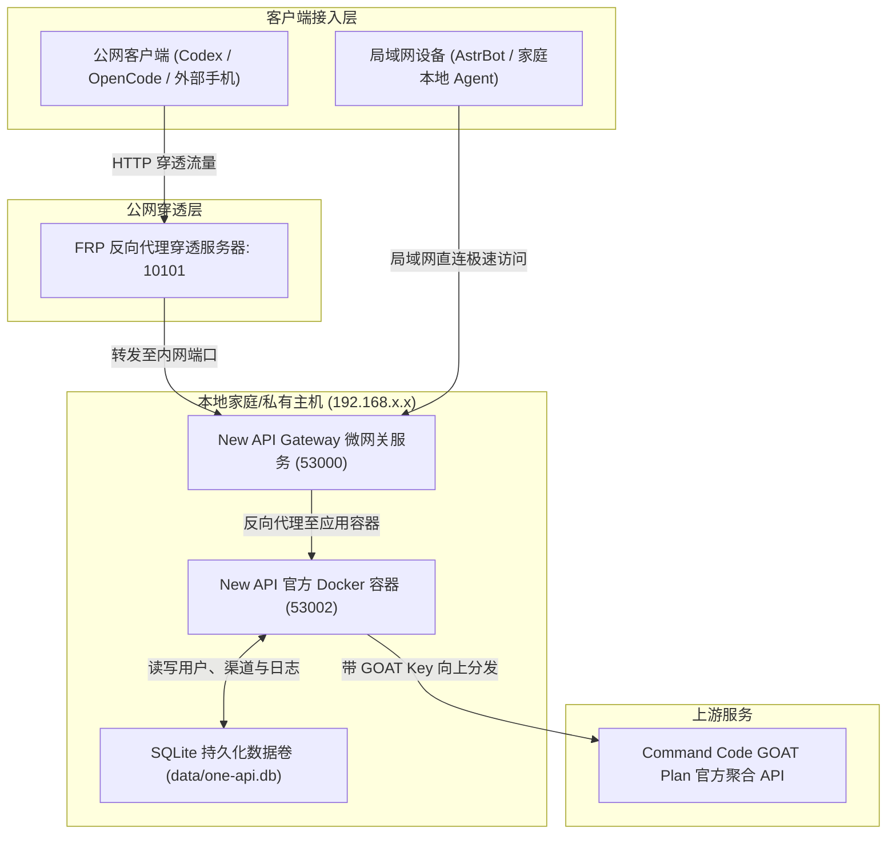

import MermaidRenderer from '../../components/MermaidRenderer.vue';

<MermaidRenderer client:load />

## 🏛️ 网络与分发架构拓扑



---

## 📋 常用运维命令速查 (示范示例)

### 1. 服务状态与启停

```bash
# 查看应用容器状态
docker ps | grep new-api

# 重启 New API 容器
docker restart new-api

# 查看应用实时日志
docker logs -f new-api --tail 100

# 查看前端网关守护进程状态
systemctl status newapi-gateway
```

### 2. SQLite 数据库安全备份

数据持久化挂载于宿主机目录（如 `/path/to/new-api/data`）：

```bash
# 进入挂载的数据目录
cd /path/to/new-api/data

# 快速备份当前数据库
cp one-api.db one-api.db.bak_$(date +%Y%m%d_%H%M%S)

# 查看数据库完整性
sqlite3 one-api.db "PRAGMA integrity_check;"
```

### 3. Docker 资源清理

```bash
# 清理废弃镜像与构建缓存
docker system prune -f
```
